# Architecture and wire protocol

```mermaid
flowchart LR
    A[Android built-in microphone] --> B[AudioRecord 48 kHz mono]
    B --> C[Bounded 20 ms PCM queue]
    C -->|Pinned TLS over local TCP| D[Windows authenticated receiver]
    D --> E[Bounded playout buffer]
    E --> F[Gain / mute / WASAPI]
    F --> G[CABLE Input]
    G --> H[CABLE Output recording device]
    H --> I[Meeting / game / OBS]
```



The desktop is a .NET 10 WPF app. Android uses a foreground microphone service, not a browser or WebView, so browser HTTPS permissions and screen-lock suspension are avoided. Audio is PCM to keep the first version transparent, dependency-light and interoperable. This trades about 768 kbit/s before transport overhead for avoiding a codec/codec negotiation dependency. TLS/TCP is intentionally LAN-only; head-of-line blocking can cause dropouts on lossy Wi-Fi. There is no claim of guaranteed latency.

## Trust and pairing

The PC creates a five-year local RSA certificate and a cryptographically random 32-byte pairing secret. The URI is:

```text
pocketmic://pair?v=1&host=<private IPv4>&port=47655&key=<64 hex>&fp=<SHA256 certificate hex>&name=<URL-encoded computer name>
```

The Android app validates the URI, asks the user to confirm the scanned computer, and saves it encrypted using an Android Keystore AES-GCM key. Merely opening a deep link never starts recording. Backup and device-transfer rules exclude stored credentials. Windows stores the certificate and token with per-user DPAPI, never in the repository or executable.

During TLS, Android accepts only the exact certificate fingerprint scanned from the PC, also checking certificate validity. That fingerprint is the trust anchor; DNS / public CA trust is unnecessary for a local private IP. A changed or unverified certificate fails closed before sending a token. After TLS, the PC compares the token in constant time, validates the audio format, and admits only one authenticated session. At most eight pending clients are handled; handshakes / authentication time out after eight seconds. Only RFC1918, loopback and IPv4 link-local sources are accepted. A hostile local peer can still cause denial of service; this is not a public-facing server.

Resetting pairing replaces the token and closes the current connection. Pairing remains valid across application restarts and needs to be scanned again after the PC's IP changes. No discovery packets, analytics, audio cloud services or background autostart.

## Framing, version 1

All header integers are network byte order. Audio payload samples are **little-endian signed PCM16**.

| Offset | Size | Field |
|---|---|---|
| 0 | 4 | ASCII `PMIC` |
| 4 | 1 | Version `1` |
| 5 | 1 | Type: HELLO 1, ACCEPT 2, AUDIO 3, PING 4, PONG 5, STOP 6, ERROR 7 |
| 6 | 2 | Reserved, must be zero |
| 8 | 4 | Unsigned sequence, consecutive for audio, wraps at uint32 |
| 12 | 4 | Payload byte count, maximum 8192 |
| 16 | N | Payload |

HELLO is UTF-8 JSON: `token`, `deviceName`, `sampleRate:48000`, `channels:1`, `bits:16`, `frameSamples:960`. ACCEPT contains the accepted sample rate; ERROR contains a human-readable `message`. AUDIO must be exactly 1920 bytes. STOP has no payload. PC sends an eight-byte monotonic timestamp in PING after every 50 audio packets; phone returns it unchanged in PONG. The PC computes RTT using its own clock, so clocks need not be synchronized. Peer reads time out to break dead connections.

Android continuously captures full 960-sample frames, selects the built-in microphone when available, and optionally enables platform noise suppression / echo cancellation. The three-frame sender queue drops oldest entries when full; frames older than 120 ms are discarded before writing. A slow TLS socket cannot cause an unbounded application queue. Audio sequence numbers count **sent**, not captured, frames.

Windows primes the playout buffer at 40 / 60 / 100 ms and inserts silence on underrun. Above the target plus 60 ms it sheds stale samples, preventing steadily growing application latency. Output gain clamps to the valid float range; muted samples are consumed, not replayed later. Disconnect clears buffered audio. WASAPI and virtual-driver latency are additional to the displayed buffer.

Android foreground service lifetime owns recorder, socket, Wi-Fi lock and wake lock. Reconnect uses 0.5–5 second bounded backoff. A user stop, permission failure, invalid token or certificate mismatch ends capture; service process death does not restart recording automatically.

## Primary references

- [Android microphone foreground services](https://developer.android.com/develop/background-work/services/fgs/service-types#microphone)
- [AudioRecord](https://developer.android.com/reference/android/media/AudioRecord)
- [NAudio WASAPI output](https://github.com/naudio/NAudio/blob/v2.2.1/Docs/WasapiOut.md)
- [VB-CABLE device routing](https://vb-audio.com/Cable/)
- [Microsoft virtual audio driver samples](https://learn.microsoft.com/en-us/windows-hardware/drivers/audio/sample-audio-drivers)
